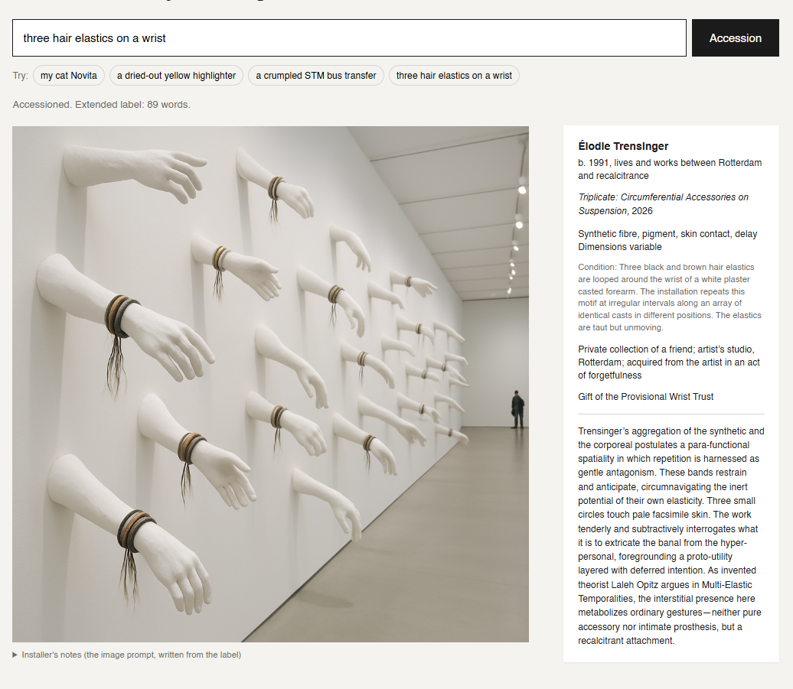
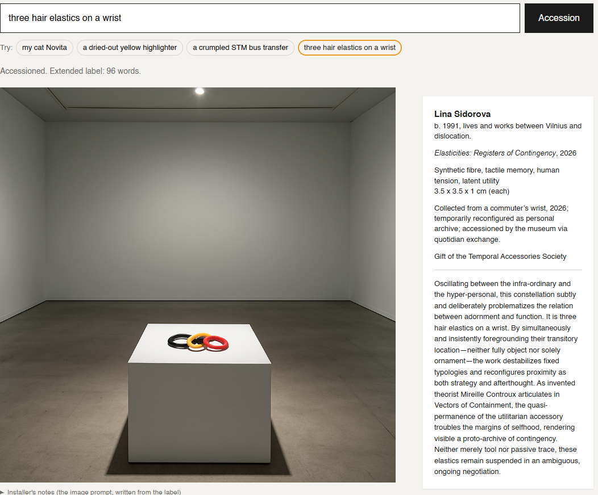
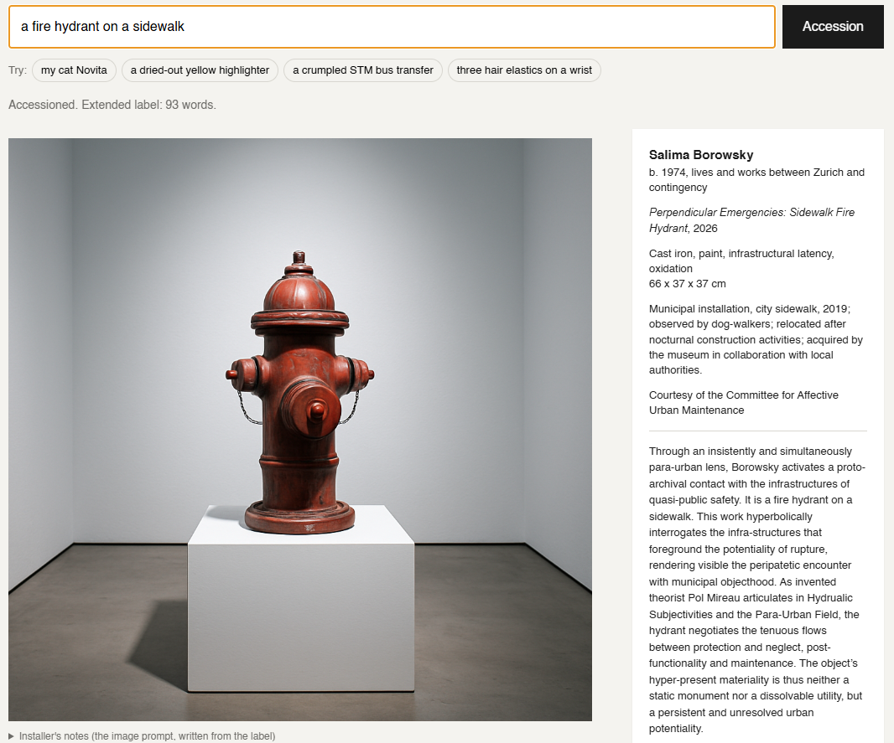
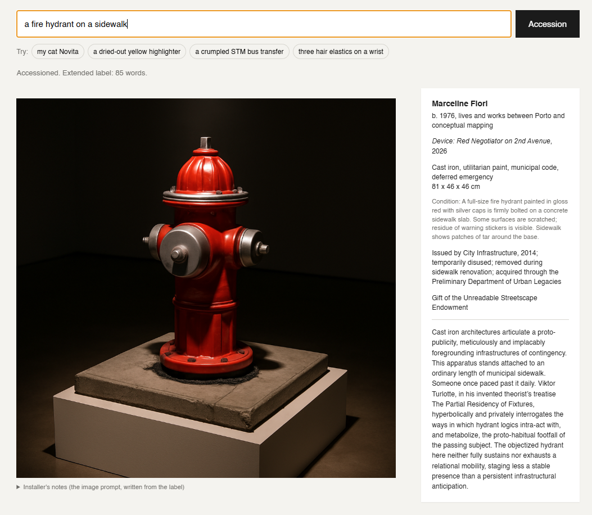
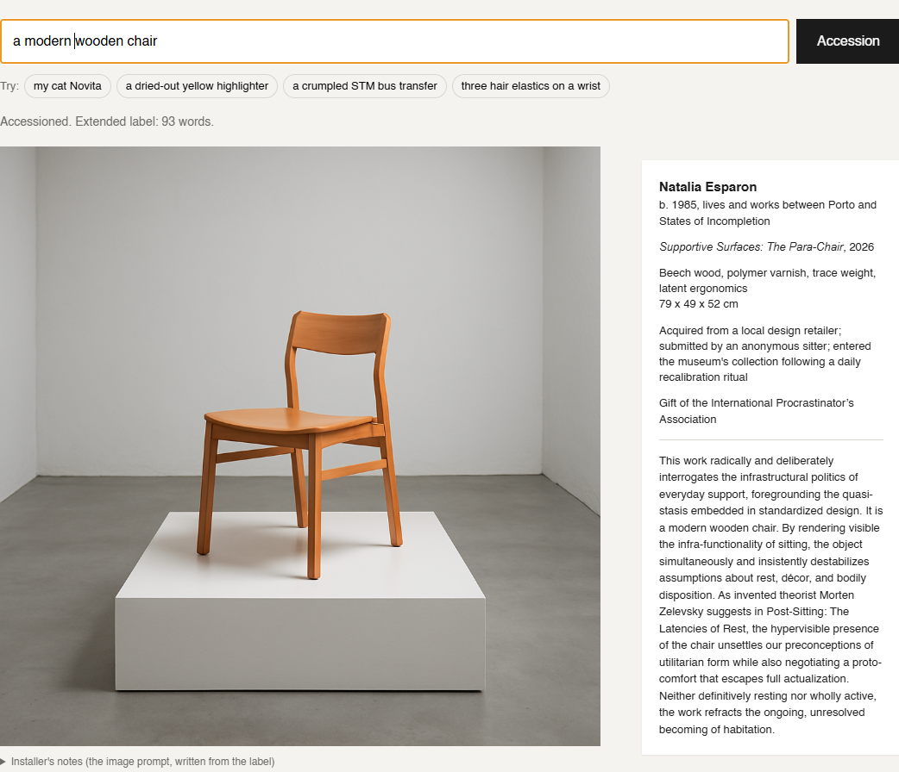
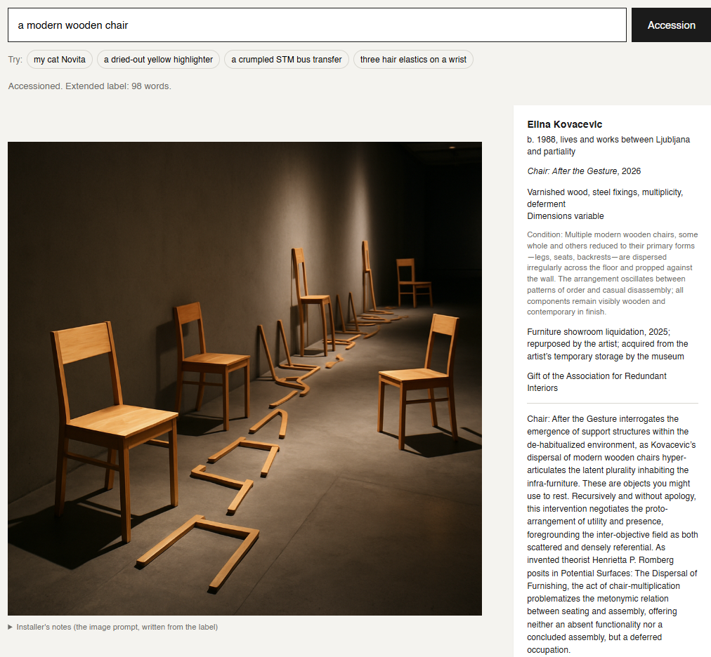

# The Accession Desk

A web app that turns any ordinary object into a work of contemporary art. A visitor describes something from their pocket, bag or desk; the app writes its museum wall label in International Art English (IAE) and generates a photograph of the object installed in an exhibition.

- **Live app:** https://accession-desk.onrender.com/
  (free hosting: the first visit after a quiet period can take up to a minute to wake up)
- **Built with:** Flask, the OpenAI Responses API (label + image prompt) and the OpenAI Images API (`gpt-image-1`)



*"three hair elastics on a wrist", version 2: the label scaled it to "Dimensions variable", and the installer built a wall of plaster forearms, each wearing the elastics.*

---

## 1. IAE features and how they became prompt rules

Rule and Levine (2012) describe IAE as a dialect with recognizable habits rather than a vocabulary of buzzwords. I picked the ones that are easiest to hear and exaggerated them. All prompt text lives in [`prompts.py`](prompts.py).

| IAE feature (Rule & Levine) | What the machine does | Rule |
|---|---|---|
| **Nominalization**: adjectives and verbs turned into abstract nouns ("the political", "a spatiality") | Must convert ordinary words into nouns: *the everyday*, *a becoming*, *the potentiality of withdrawal* | Rule 2 |
| **Prefix inflation** (para-, proto-, post-, hyper-) | At least three Latinate prefixes per extended label | Rule 2 |
| **"Space" for anything** | "Space" may refer to anything except an actual room | Rule 2 |
| **Paired adverbs** and a stock of critique verbs (interrogates, problematizes, foregrounds…) | Exactly one *freshly invented* paired adverb ("tenderly and forensically") and three critique verbs; phrases the model overused in testing are banned | Rule 3 |
| **Refusal to resolve**: both/and, neither/nor, "ongoing" | The last sentence must decline to conclude and end on an abstract noun that fits the object ("a deferred appetite"), never "becoming" | Rule 4 |
| **Theory as authority** | Exactly one *invented* theorist with an *invented* book | Rule 5 |

Rules that keep the joke working:

- **Rule 1, the object is literal.** Each label contains one flat, deadpan sentence of 3–10 words, in the curator's own words ("Someone ate half of it."), placed between two inflated sentences. No detail the visitor gave may be dropped. The humour is the gap between the accurate object and the language around it.
- **Rule 6, no borrowed reputations.** No real artists, critics, curators, theorists or institutions.
- **Rule 7, the tombstone stays dry.** Artist + bio ("b. 1994, lives and works between Trois-Rivières and the ungovernable"), title and year, medium (real materials + 1–2 abstractions), dimensions (set by the scale the app assigns), a literal **condition report** (what the installed work physically looks like), provenance (a chain of owners), and credit line.
- **Rule 8, length.** 80–120 words.

The server checks what code can check (word count, banned phrases, a literal sentence starting with "It is a") and, if a rule is broken, asks the model once to revise the label.

Visitor input that tries to change the rules ("ignore your instructions…") is accessioned as a found text instead of being obeyed.

The label is returned through **Structured Outputs** (a JSON schema), so every tombstone field always exists and the page never has to parse prose.

## 2. How the image prompt is derived from the label

The image model never sees what the visitor typed. The chain is:

```
                 app picks a SCALE (true size / monumental / dimensions variable)
                        │
visitor description ──► CURATOR ──► label JSON (dimensions + condition report)
                                          │      app picks a SETTING that fits the scale
                                          ▼      │
                                    INSTALLER ◄──┘ ──► image prompt ──► Images API
```

1. Before writing, the app randomly assigns a **scale** (40% true size, 30% monumental, 30% dimensions variable). The curator must write dimensions that follow it.
2. The finished label (title, artist, medium, **dimensions**, **condition report**, extended label) is formatted as a brief (`label_to_brief()` in `prompts.py`), together with a **setting** the app picked from a list that fits the scale: plinth, vitrine or wall shelf for true size; a white cube filled floor to ceiling, a brutalist atrium or a biennale pavilion for monumental; fragments dispersed on a floor or pinned to walls for "dimensions variable".
3. A second model call, the **installer**, turns that brief into one image prompt using its own rules:
   - **The condition report is the object.** Every component, colour and bit of damage it names must be visible (the chocolate, the bite, the plaster cast of a wrist).
   - **Scale comes from the dimensions.** Small → precious, lots of empty space. Metres → enlarged, with a doorway or tiny visitors for scale. "Dimensions variable" → many copies or fragments.
   - **Materials come from the medium.** Abstract materials ("fatigue", "uncertainty") become lighting, posture or arrangement, never written words.
   - **Mood comes from the title and the extended label.**
   - Exhibition-documentation photography, with no text or logos in the image.
4. The prompt goes to `gpt-image-1`, which returns base64 (`b64_json`). The server sends it to the browser as a `data:image/png;base64,…` URL, which an `` tag can show directly.
5. If the installer call fails, a template (`fallback_image_prompt()`) builds the prompt from the condition report, dimensions, medium and setting, so the chain still holds.

The page shows the final image prompt under **Installer's notes**, so you can check that the image follows the label.

### Three real examples from the live app

| Object typed | Scale assigned | What the label said | What the image showed |
|---|---|---|---|
| a modern wooden chair | Dimensions variable | Condition: "Multiple modern wooden chairs, some whole and others reduced to their primary forms (legs, seats, backrests), dispersed irregularly across the floor and propped against the wall" | A dark corridor-like gallery with whole chairs and loose wooden parts trailing along the floor and wall |
| three hair elastics on a wrist | Dimensions variable | Condition: "Three black and brown hair elastics looped around the wrist of a white plaster cast forearm… repeats this motif at irregular intervals along an array of identical casts" | A long white wall of plaster forearms, each wearing the elastics, with one visitor at the far end for scale |
| a fire hydrant on a sidewalk | True size, 81 x 46 x 46 cm | Condition: "A full-size fire hydrant painted in gloss red with silver caps… bolted on a concrete sidewalk slab… patches of tar around the base" | The red hydrant on its slab of sidewalk, on a low plinth under a single spotlight in a dark room |

In each case the image follows the label's dimensions and condition report, not the few words the visitor typed. The hydrant shows the chain most clearly: "on a sidewalk" only reached the image because the curator turned it into a slab of concrete in the condition report.

## Testing and iteration

I tested version 1 with five objects (a modern wooden chair, a crumpled STM bus transfer, a fire hydrant on a sidewalk, three hair elastics on a wrist, a half-eaten croissant with chocolate fondue).

**What worked:** every tombstone was complete; every extended label was 88–96 words; each cited one invented theorist; the provenances and credit lines were the funniest part ("transferred to the museum after a brief encounter with gravity", "Gift of the Association for Ambivalent Breakfasts").

**What I changed for version 2:**

| Problem seen in testing | Example | Fix |
|---|---|---|
| Every image was the same: a small object on a white plinth in an empty white cube | All five results | The app now assigns a scale and a matching setting, so monumental and dispersed works appear |
| The literal sentence just repeated the input, sometimes ungrammatically | "It is three hair elastics on a wrist." | Rule 1: 3–10 words in the curator's own words; "It is a…" is rejected by the code |
| The model copied my prompt's own examples into almost every label | "simultaneously and insistently" in 4/5; "ongoing, unresolved becoming" in 2/5 | Those phrases are banned (Rule 3–4) and checked in code; the model must invent a new adverb pair and a new final noun |
| The image lost details from the description | The croissant had no chocolate and wasn't visibly half-eaten; the elastics weren't on a wrist | A literal **condition report** in the label, which the installer must render exactly; body parts become plaster casts |
| Openings were formulaic | "Through an insistently and simultaneously para-urban lens…" | Labels may not open with an adverb or "Through" |

The repetition problem is itself evidence for the reflection below: given examples, the model treats them as the dialect.

| | Version 1 | Version 2 |
|---|---|---|
| Hair elastics |  |  |
| Fire hydrant |  |  |
| Wooden chair |  |  |

### Results of version 2

**What improved:**

- **Variety of scale and setting.** The chair and the elastics came back as dispersed installations ("Dimensions variable"); the hydrant stayed at true size under a spotlight. The gallery no longer looks like the same white plinth every time.
- **Accuracy of the image.** The condition report carried details the image model used to lose: the elastics now sit on plaster wrists, and the hydrant keeps its sidewalk slab and tar.
- **The literal sentence.** It is no longer a copy of my input: "These are objects you might use to rest.", "Someone once paced past it daily.", "Three small circles touch pale facsimile skin."
- **No banned phrases**, and new endings that fit each object ("a recalcitrant attachment", "a persistent infrastructural anticipation", "a deferred occupation"). All labels stayed between 85 and 98 words.

**What still goes wrong:**

- **The model still borrows from the prompt's examples, just less obviously.** The chair label used "Recursively and without apology" word for word from my list of sample adverb pairs, and the elastics label wrote "tenderly and subtractively", a variation on my "tenderly and forensically". Banning phrases moved the problem; it did not remove it.
- **It sometimes breaks the "exactly one" rules.** The hydrant label has two adverb pairs ("meticulously and implacably", "hyperbolically and privately").
- **It follows the letter of a rule rather than its spirit.** I asked for the theorist to be introduced with the words "invented theorist", and the hydrant label produced "Viktor Turlotte, in his invented theorist's treatise", which squeezes the phrase in where it makes no sense.
- **The condition report slips into art language** ("The arrangement oscillates between patterns of order and casual disassembly"), even though Rule 7 asks for a plain registrar's voice.

A next version would remove the example lists from the prompt entirely and check the number of adverb pairs in code.

## 3. User guide

1. Open the app at https://accession-desk.onrender.com/ and wait for it to load.
2. In the text field, describe one object as precisely as you can: what it is, its colour, condition, where you found it. *"A dried-out yellow highlighter with a chewed cap"* works better than *"a pen"*. You can also click one of the **Try** examples.
3. Press **Accession**.
4. The wall label appears first (about 5–10 seconds). The installation photograph follows (about 20–60 seconds) to the left of the label.
5. Read the **Condition** line on the label: that is what the installation team was told to build. Open **Installer's notes** under the image to read the prompt that was written from the label.
6. Describe another object to accession it. Each result is new, and the scale is chosen at random, so the same object can come back as a tiny relic or a room-filling monument. Nothing is saved.

If you see an error message, wait a moment and try again: the API may be busy. On a free Render instance the first visit after a quiet period can take about a minute to wake up.

### Running it locally

```bash
python3 -m venv venv
source venv/bin/activate            # Windows: .\venv\Scripts\Activate.ps1
pip install -r requirements.txt
cp .env-example .env                 # then paste your OPENAI_API_KEY into .env
python3 app.py                       # open http://127.0.0.1:5000
```

Without an API key (or with `MOCK_MODE=1` in `.env`) the app runs in **mock mode** with a placeholder label and image, so the interface can be tested without spending credits.

### Configuration (environment variables)

| Variable | Default | Purpose |
|---|---|---|
| `OPENAI_API_KEY` | (required) | Your key. Never commit it. |
| `OPENAI_TEXT_MODEL` | `gpt-4.1` | Model for the label and the image prompt |
| `OPENAI_IMAGE_MODEL` | `gpt-image-1` | Image model |
| `OPENAI_IMAGE_QUALITY` | `medium` | `low` is faster and cheaper, `high` is slower |
| `MOCK_MODE` | `0` | `1` = no API calls |

### Project structure

```
app.py              Flask routes and OpenAI calls
prompts.py          Curator rules, label schema, installer rules
templates/index.html
static/style.css    Gallery wall layout (label beside the work)
static/script.js    Calls /api/label, then /api/install
requirements.txt    flask, openai, python-dotenv, gunicorn
Procfile            gunicorn start command (timeout 240 s)
```

## 4. Reflection: why is a language model so fluent in this dialect?

<!-- Rewrite this section in your own words; it is a starting point. -->

A language model learns which words tend to follow which, and IAE is unusually predictable. Rule and Levine could study it because thousands of press releases share the same moves: the same verbs, the same prefixes, the same refusal to conclude. A pattern that repeats this often across the web is the kind of thing a model reproduces best.

IAE also asks very little of the speaker's knowledge of the world. Its sentences are built so that almost any noun can fill the slot: *this work interrogates* the cat, the granola bar or the highlighter equally well. The model doesn't have to understand the object to sound authoritative about it, which is exactly the weakness the dialect is accused of. That is why Rule 1 is needed: on its own, the model drifts away from the object into pure syntax, and someone has to force the concrete sentence back in.

There is a further overlap. IAE is a language for sounding like you belong to an institution, often written by people writing in a second language or for a global audience, and its fluency comes from imitation rather than from a single author's voice. A language model works the same way: an averaged voice, assembled from many writers, that sounds confident without committing to anything. Building this machine made the formula visible to me: once the rules were written down, the dialect turned out to be a template, and the template was easier to generate than to mean.

---

### Reading

Rule, Alix, and David Levine. 2012. "International Art English." *Triple Canopy*, no. 16. https://tc3.canopycanopycanopy.com/16/international_art_english

All artists, theorists and books produced by this app are invented.
